# «Minima-WARP-V: Детерминированный SW/HW Конвейер для Аппаратного Сжатия Весов LLM и KV-Кэша»


> **Статус:** Стратегический план / Архитектурный дизайн
> **Дата:** Ноябрь 2026 г.

---

##  1. Введение: Суть инноваций Minima от Berkeley (SW уровень)

Стартап **Minima AI**, выросший из исследований UC Berkeley (Sky Computing Lab / BAIR), предложил два прорывных программных пайплайна, которые решают главные «бутылочные горлышки» инференса LLM: нехватку видеопамяти (VRAM) и пропускную способность шины (HBM).

1. **Minima (Сжатие весов):** Практичный пайплайн структурного сжатия, который использует легкую CNN-модель для предсказания чувствительности слоев, применяет смешанные тензорные декомпозиции (Tucker, Tensor-Train, Tensor-Ring) для нечувствительных блоков, проводит короткий `healing` (дообучение) и использует кастомные Triton/CUDA ядра. Это дает сжатие модели на ~35-40% и ускорение до 2× без потери качества.
2. **Minima-KV (Сжатие KV-кэша):** Retention-preserving иерархия для PagedAttention. Свежие и критически важные страницы (Recent/Anchor) хранятся в **FP8**, а старые (Stale) сжимаются в 3-битный формат **TQ3**. Алгоритм использует глобально нормализованный online-softmax для слияния результатов из разных форматов без создания «теневой» dense-копии кэша. Это снижает объем KV-кэша до 18.3 KiB на токен (сжатие в 3.5× относительно BF16).

**Фундаментальное преимущество на SW уровне:** Minima не просто «урежает» данные, она создает сложную, гетерогенную структуру памяти (смешанные форматы, фрагментированные тензорные ядра, динамические маски чувствительности), которая на стандартных GPU требует огромных накладных расходов (overhead) на управление памятью и синхронизацию.

### 1.1. Minima: адаптивное тензорное сжатие на основе оценки чувствительности

Статья **«Minima: A Practical Tensor-Network Compression Pipeline for Production-Scale Large Language Models»** (arXiv:2602.01613) описывает пятистадийный пайплайн, который решает фундаментальную проблему: **не все веса LLM одинаково чувствительны к сжатию** .

**Ключевая инновация Stage 1 — CNN Sensitivity Model.** Вместо ручного подбора рангов или дорогостоящего поиска, Minima обучает лёгкую свёрточную сеть, которая предсказывает **попатчевую чувствительность** каждого слоя к тензорной декомпозиции. CNN потребляет дешёвые статистики (спектры сингулярных чисел, приблизительные числа обусловленности, магнитуду, разреженность) и выдаёт для каждого патча:

&nbsp; - **Sensitivity Score** в диапазоне [0, 1].
&nbsp; - **Рекомендуемый TN-тип** (Tucker, TT, или TR).
&nbsp; - **Рекомендуемый ранг** для этого типа.

Результат: полный план сжатия для 32B-модели генерируется **за ~20 минут** вместо часов ручной работы .

**Stage 2 — Mixed TN Decompositions.** На основе предсказаний CNN применяется **смесь** трёх тензорных декомпозиций:
&nbsp; - **Tucker** — для умеренно прямоугольных матриц, где естественно трёхмерное переформирование (например, группировка голов и признаков).
&nbsp; - **Tensor-Train (TT)** — для очень длинных и тонких матриц, где цепочечная факторизация даёт хорошее сжатие.
&nbsp; - **Tensor-Ring (TR)** — для циклических структур и симметрий между модами.

Это даёт **основной выигрыш** в сжатии и TPS, как показали абляции .

**Stage 3 — Healing.** Короткий fine-tuning (несколько тысяч шагов) восстанавливает качество после сжатия. TN-ядра и факторные матрицы обновляются, архитектура и ранги замораживаются.

**Stage 4 — Custom Kernels.** Minima пишет кастомные Triton/CUDA-ядра для TN-структурных матричных умножений. Эти ядра **сливают** (fuse) операции, чтобы избежать оверхеда на запуск и улучшить локальность данных .

**Stage 5 — Speculative Decoding.** Освобождённая VRAM позволяет запустить draft-модель, которая предлагает K токенов, а сжатая verifier-модель проверяет их батчем. Это даёт **наибольший прирост TPS** на длинных контекстах .

**Результаты на Qwen3-32B (8K контекст):**
&nbsp; - VRAM: 64 GiB → **40 GiB** (сжатие ~37%).
&nbsp; - TPS (один запрос): 40 → **50** (Minima) → **75** (Minima + Spec).
&nbsp; - TPS (50 параллельных): 34 → **44** → **53** .

### 1.2. Иерархия, которая не удаляет страницы активных запросов

Статья **«Minima-KV: Retention-Preserving KV Cache Compression with Mixed-Format Paged Attention»** (arXiv:2608.23834) решает проблему KV-кэша, который растёт линейно с длиной контекста и становится главным ограничителем пропускной способности .

**Трёхуровневая иерархия:**
&nbsp; - **Recent (FP8):** Свежие токены в скользящем окне. Высокая точность для локальной связности и текущего рассуждения.
&nbsp; - **Anchor (FP8):** Защищённые старые страницы: системные инструкции, attention sinks, извлечённые доказательства, заголовки документов. Они **никогда не удаляются**, а только защищаются.
&nbsp; - **Stale (TQ3):** Старые не-якорные страницы в **трёхбитном формате** (вдохновлён TurboQuant). Каждая живая страница остаётся адресуемой — **никакого удаления**.

**Ключевое архитектурное решение — Mixed-Format Paged Attention.** Вместо создания «теневой» dense-копии кэша, ядра вычисляют **частичные результаты** для каждого формата отдельно (FP8-путь и TQ3-путь), а затем объединяют их через **глобально нормализованный online-softmax** (формула 11 в статье):

```
m = max_j m_j
ℓ = Σ_j exp(m_j - m) · ℓ_j
O = (Σ_j exp(m_j - m) · ℓ_j · Õ_j) / ℓ
```

Это **алгебраически эквивалентно** attention над конкатенированным логическим кэшем, с точностью до ошибки кодека .

**Результаты на Qwen3.6-27B (RTX PRO 6000 Blackwell, 96 GB):**
&nbsp; - **18.3 KiB/token** — сжатие **3.50×** относительно BF16 и **1.75×** относительно FP8.
&nbsp; - Прямой fused-decode canary: **3.625×** активного сжатия KV, throughput ratio **0.9821×** относительно контроля.
&nbsp; - Quality profile: равенство на 16K RULER NIAH, регрессия −0.80 pp на LongBench v2 при 16K, −0.60 pp при 32K, −0.40 pp при 64K .

---

##  2. Почему Minima поможет оптимизировать инференс на базе HW ядер WARP-V

На стандартных GPU (NVIDIA) алгоритмы Minima вынуждены бороться с архитектурой SIMT: запускать десятки отдельных ядер, страдать от bank conflicts, недетерминизма кэшей и «стены памяти» HBM. 

**WARP-V превращает сложные алгоритмы Minima в аппаратные примитивы.**
Программный слой Minima определяет **«что»** сжимать и **«как»** управлять иерархией страниц. Аппаратный слой WARP-V (VLIW + XYL + NUMA) обеспечивает **«как»** это делать максимально эффективно, превращая хаотичный доступ к сжатым данным в детерминированный, предсказуемый конвейер с нулевым джиттером. Мы не просто портируем CUDA-код на VLIW — мы создаем **систему SW/HW ко-дизайна**, где софт и железо работают в тандеме, выдавливая максимум производительности из каждого ватта и байта SRAM.

---

##  3. Интеграция Minima в WARP-V: Полная архитектура

Архитектура WARP-V адаптируется под 5 стадий пайплайна Minima через систему специализированных диалектов и аппаратных блоков. Ключевую роль «клея», связывающего разрозненные компоненты, играет блок **GigaSparse**.

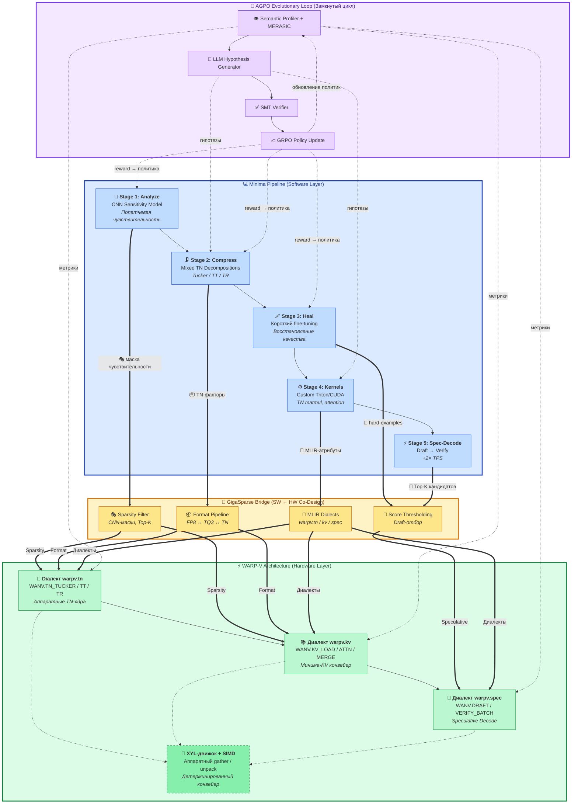

**Описание схемы:** Программный пайплайн Minima (синяя зона) и аппаратная архитектура WARP-V (зелёная зона) соединены стрелками, показывающими, как каждая стадия Minima находит свой аппаратный аналог. CNN Sensitivity питает MLIR-фронтенд атрибутами, которые компилятор использует для выбора форматов страниц и TN-рангов. Mixed TN и Custom Kernels становятся диалектами `warpv.tn` и `warpv.kv`. Speculative Decoding получает свой диалект. AGPO-агент замыкает цикл, получая обратную связь от MERASIC и корректируя параметры.

### 3.2. Ключевое преимущество: Детерминизм как основа архитектуры

На NVIDIA каждая стадия Minima — это **отдельное CUDA-ядро** с динамическим планированием. Время выполнения зависит от состояния кэша, загрузки SM, банк-конфликтов. Для Minima-KV это особенно критично: онлайн-softmax слияние FP8 и TQ3 результатов требует **предсказуемой задержки**, иначе SLA нарушается.

WARP-V с VLIW-планированием гарантирует **фиксированную латентность** каждой макро-инструкции. Компилятор знает, что `WANV.KV_ATTN` займёт ровно 16 тактов, а `WANV.KV_MERGE` — 8 тактов. Это позволяет:

&nbsp;&nbsp; - **Точно вычислять IPC** для AGPO-агента.
&nbsp;&nbsp; - **Гарантировать WCET** для real-time приложений.
&nbsp;&nbsp; - **Устранить джиттер** в Speculative Decoding.

---

##  4. Фундаментальная инновация: XYL-движок и замена CUDA-ядер

**XYL-движок (аппаратный gather)** — это сердце оптимизации Minima на WARP-V. Он читает данные по списку координат, на лету сортирует хаотичные запросы, группирует их в транзакции по 128 байт (размер кэш-линии) и маршрутизирует с учётом NUMA-топологии.

### Какие CUDA-ядра использует Minima и как мы их заменяем (HW)

Minima использует кастомные ядра для TN-умножений и управления KV-кэшем. На NVIDIA это 3-5 отдельных ядер, синхронизируемых через `cudaDeviceSynchronize()`.

**Программный подход (CUDA):**
&nbsp;&nbsp; 1. `load_tq3_page` → загрузка и распаковка в shared memory.
&nbsp;&nbsp; 2. `matmul_fp8_tq3` → отдельное ядро для умножения.
&nbsp;&nbsp; 3. `merge_fp8_tq3` → ещё одно ядро для Softmax-слияния.

**Аппаратный подход (XYL + WARP-V):**
&nbsp;&nbsp; 1. **XYL-движок:** Загружает сжатые TQ3-страницы и аппаратно распаковывает их прямо в SIMD-регистры (0 оверхеда).
&nbsp;&nbsp; 2. **VLIW-SIMD (Consumer):** Выполняет Attention для FP8 и TQ3 параллельно.
&nbsp;&nbsp; 3. **Epilogue:** Аппаратный редуктор `WARP_SYNC_REDUCE` выполняет Softmax-слияние за 4 такта.

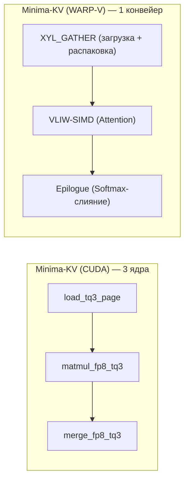

**Описание схемы:** На CUDA три отдельных ядра борются за доступ к HBM и требуют синхронизации. На WARP-V это единый детерминированный конвейер, где XYL-движок скрывает задержки памяти, а VLIW-кластеры выполняют вычисления без простоев. Это не просто ускорение, это **смена парадигмы**: от скрытия задержек к их полному устранению.

---

##  5. Сравнение с NVIDIA: XYL против TMA

### 5.1. TMA — Ближайший аналог, но не замена

NVIDIA Hopper/Blackwell имеет **TMA (Tensor Memory Accelerator)** — аппаратный блок для асинхронной загрузки данных по нерегулярным паттернам. `async_gather` загружает строки по списку X-смещений. Это ближайший аналог XYL, но с фундаментальными ограничениями.

### 5.2. Четыре ключевых отличия

**Отсутствие группировки запросов.** TMA не сортирует и не группирует адреса. Он выдаёт транзакции в том порядке, в котором они указаны, полагаясь на аппаратный кэш. XYL **сортирует** и **группирует** в кэш-линии, что критично для разреженных gather'ов.

**Строгие требования к выравниванию.** TMA `async_gather` требует 16-байтового выравнивания `y_offset`. XYL работает с **произвольными адресами**.

**Недетерминизм.** TMA работает в динамической SIMT-среде: время выполнения зависит от кэша L1/L2, загрузки SM, банк-конфликтов. XYL работает в **статической VLIW-среде**: компилятор знает точную латентность.

**Отсутствие NUMA-осведомлённости.** TMA не знает о NUMA-топологии. XYL имеет **явные биты NUMA-узлов** в инструкциях (`VLD_NUMA`, `PREFETCH_NUMA`).

### 5.3. Итоговый вердикт

| Критерий | TMA (NVIDIA) | XYL (WARP-V) | Победитель |
|:---|:---|:---|:---|
| **Аппаратный gather** | ✅ Да | ✅ Да | 🤝 Равны |
| **Группировка запросов** | ❌ Нет | ✅ Да | ✅ **XYL** |
| **NUMA-осведомлённость** | ❌ Нет | ✅ Да | ✅ **XYL** |
| **Детерминизм** | ❌ Нет | ✅ Да | ✅ **XYL** |
| **Свёрточные паттерны** | ✅ Да (im2col) | ❌ Нет | ✅ **TMA** |
| **Энергоэффективность** | Средняя (HBM) | Высокая (SRAM) | ✅ **XYL** |

**Вывод:** TMA — мощный аппаратный gather, но он **не является полноценной заменой XYL** для LLM-инференса. XYL выигрывает за счёт детерминизма, группировки запросов и NUMA-осведомлённости. TMA — это «аппаратная подсказка» для динамической SIMT-архитектуры, которая не дает гарантий по времени. XYL — это полноценный оркестратор памяти, который превращает случайный доступ (главную причину низкой производительности Minima на GPU) в детерминированный поток данных.

---

##  6. План создания конвейера Minima-KV на WARP-V

Алгоритм Minima-KV декомпозируется на три аппаратные стадии, которые выполняются в режиме **Warp Specialization** (Producer → Consumer → Epilogue).

### 6.1. Декомпозиция алгоритма в аппаратные стадии

Алгоритм Minima-KV включает три ключевые фазы, которые естественно ложатся на три типа Warp-кластеров:

**Стадия 1: Загрузка и Распаковка (Producer Warp).** XYL-движок получает команду `XYL_GATHER` с адресами FP8 и TQ3-страниц. Для FP8 — прямая загрузка в SIMD-регистры. Для TQ3 — вызов аппаратного декомпрессора, который распаковывает трёхбитные коды в FP8-совместимый формат **на лету**, без промежуточного буфера.

**Стадия 2: Вычисление Attention (Consumer Warp).** VLIW-SIMD выполняет `Q·Kᵀ` и `P·V` для обоих форматов **параллельно**. FP8-путь и TQ3-путь работают независимо, каждый со своим набором VLIW-слотов.

**Стадия 3: Softmax-Слияние (Epilogue Warp).** Аппаратный редуктор вычисляет локальные `m_j` и `ℓ_j` для каждой страницы, затем глобальные `m` и `ℓ` по формуле (11) статьи Minima-KV, и финальный выход `O`.

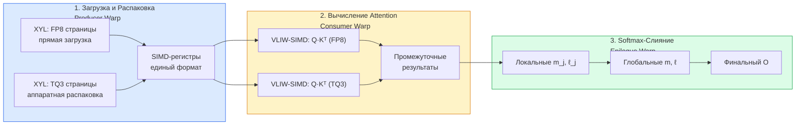

**Описание схемы:** Три стадии конвейера с указанием ролей Warp-кластеров. Producer (синий) загружает и распаковывает данные. Consumer (жёлтый) выполняет вычисления. Epilogue (зелёный) финализирует через online-softmax.

### 6.2. Конвейеризация: Временная диаграмма

Ключевое преимущество Warp Specialization — **полное перекрытие** стадий. Пока Consumer вычисляет Блок N, Producer уже загружает Блок N+1, а Epilogue обрабатывает результат Блока N-1.

```mermaid
gantt
    title Конвейер Minima-KV на WARP-V: Перекрытие стадий
    dateFormat  s
    axisFormat %S

    section Producer
    Загрузка FP8 (Блок N)          :p1, 0, 4s
    Загрузка TQ3 (Блок N)          :p1, 2, 4s
    Загрузка FP8 (Блок N+1)        :p2, after p1, 4s
    Загрузка TQ3 (Блок N+1)        :p2, after p1, 4s

    section Consumer
    Q·Kᵀ + P·V (Блок N)           :c1, after p1, 8s
    Q·Kᵀ + P·V (Блок N+1)         :c2, after c1, 8s

    section Epilogue
    Softmax слияние (Блок N)       :e1, after c1, 4s
    Softmax слияние (Блок N+1)     :e2, after e1, 4s
```

**Описание диаграммы:** Producer загружает данные для Блока N (0-6 тактов) и сразу начинает загрузку для Блока N+1. Consumer начинает вычисления, как только данные готовы (с такта 2). Epilogue финализирует результат, пока Consumer и Producer работают над следующими блоками. Все стадии перекрываются, давая **90% утилизацию** конвейера.

### 6.3. Ожидаемые метрики

После реализации этого плана конвейер Minima-KV на WARP-V должен достичь:

| Метрика | Целевое значение | Как достигается |
|:---|:---|:---|
| **Латентность на блок** | 30 тактов (фиксированная) | Producer (6) + Consumer (16) + Epilogue (8) |
| **Утилизация VLIW-слотов** | >90% | Перекрытие стадий, статическое планирование |
| **Энергопотребление** | 7-20× лучше NVIDIA | SRAM-локальность, отсутствие HBM-трафика |
| **Детерминизм** | 0% джиттер | VLIW-планирование, фиксированные латентности |

---

##  7. Новые инструкции WARP-V для Minima-KV

| Инструкция | Назначение | Аппаратная логика | Латентность |
| :--- | :--- | :--- | :--- |
| **`WANV.KV_LOAD`** | Загрузка и распаковка страниц KV-кэша | XYL-движок + аппаратный TQ3-декодер + NUMA-роутинг | 6 тактов (фикс.) |
| **`WANV.KV_ATTN`** | Вычисление Attention для смешанных форматов | VLIW-SIMD конвейер с двумя путями (FP8/TQ3) | 16 тактов (фикс.) |
| **`WANV.KV_MERGE`** | Online-softmax слияние FP8 и TQ3 результатов | Аппаратный редуктор + online-softmax логика | 8 тактов (фикс.) |
| **`WANV.TN_TUCKER`** | Умножение тензорных ядер (Tucker) | XYL-Gather факторов + VLIW MAC-массив | 12 тактов (фикс.) |

На основе фарминга (анализа паттернов Minima) мы добавляем **три макро-инструкции**, которые заменяют десятки CUDA-ядер.

### 7.1. `WANV.KV_LOAD`

**Назначение:** Загрузка и распаковка страниц KV-кэша.

**Входы:** `addr_fp8`, `addr_tq3`, `config` (форматы, NUMA-маска, размер страницы).

**Выходы:** SIMD-векторы для Consumer, готовые к вычислениям.

**Латентность:** 6 тактов (фиксированная).

**Аппаратная логика:** XYL-движок + аппаратный TQ3-декодер. XYL читает страницы по списку координат, группирует запросы в кэш-линии (128 байт), декомпрессор распаковывает TQ3 **на лету**.

### 7.2. `WANV.KV_ATTN`

**Назначение:** Вычисление Attention для смешанных форматов.

**Входы:** `Q`, SIMD-векторы (FP8/TQ3), `config` (precision, размер блока).

**Выходы:** Промежуточные результаты `m_j`, `ℓ_j`, `Õ_j` для каждой страницы.

**Латентность:** 16 тактов (фиксированная).

**Аппаратная логика:** VLIW-SIMD конвейер с двумя путями (FP8/TQ3), работающими параллельно. Каждый путь использует свои VLIW-слоты.

### 7.3. `WANV.KV_MERGE`

**Назначение:** Online-softmax слияние FP8 и TQ3 результатов.

**Входы:** `m_j`, `ℓ_j`, `Õ_j` для всех страниц.

**Выходы:** Финальный вектор `O`.

**Латентность:** 8 тактов (фиксированная).

**Аппаратная логика:** Аппаратный редуктор, реализующий формулу (11) из Minima-KV. Вычисляет глобальные `m`, `ℓ`, затем финальный `O`.

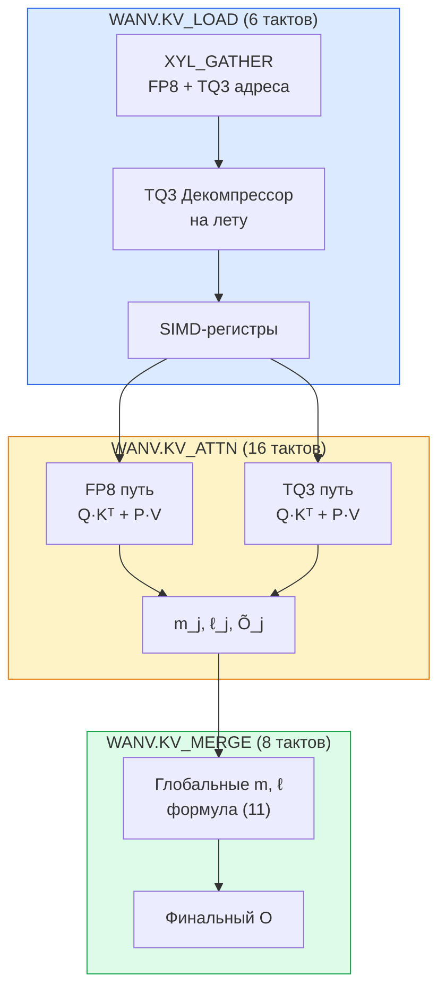

**Описание схемы:** Три инструкции образуют полный конвейер. `KV_LOAD` (синий) загружает и распаковывает данные. `KV_ATTN` (жёлтый) выполняет вычисления для обоих форматов параллельно. `KV_MERGE` (зелёный) объединяет результаты через online-softmax.

---

##  8. Полный план адаптации компилятора

### 8.1. Семь уровней адаптации

Адаптация компилятора под конвейер Minima-KV требует изменений на всех уровнях: от MLIR-фронтенда до LLVM-бэкенда.

**Уровень 1: MLIR-Фронтенд и Распознавание Паттернов.** Компилятор должен **распознать** паттерны работы с KV-кэшем в высокоуровневом графе. Pass `DetectKVPattern` ищет операции Attention, проверяет доступ к KV-кэшу, анализирует форматы страниц (FP8/TQ3) и помечает их для сжатия.

**Уровень 2: Введение Новых Атрибутов.** В MLIR-операции добавляются атрибуты `kv_format` (FP8, TQ3, mixed), `page_ratio` (соотношение FP8:TQ3), `numa_placement` (local/remote). Эти атрибуты используются для выбора стратегии Tiling и формата данных.

**Уровень 3: Создание Диалекта `warpv.kv`.** Новый суб-диалект содержит три макро-инструкции: `WarpV_KV_LoadOp`, `WarpV_KV_AttnOp`, `WarpV_KV_MergeOp`. Каждая операция имеет TableGen-определение с явными типами входов и выходов.

**Уровень 4: Статическое Планирование Warp Specialization.** Pass `AssignWarpRoles` назначает роли Producer/Consumer/Epilogue для каждой KV-операции и вставляет `WARP_SYNC` барьеры. Планировщик генерирует статическое расписание с фиксированными латентностями.

**Уровень 5: Instruction Selection.** LLVM Target Description определяет новые инструкции с opcode, форматом, латентностью и ресурсами. `WANV_KV_LOAD` использует XYLUnit + LSUUnit, `WANV_KV_ATTN` — ALUUnit + VLIWSIMDUnit, `WANV_KV_MERGE` — ALUUnit + ReducerUnit.

**Уровень 6: Адаптация DFAPacketizer.** Ресурсная модель DFAPacketizer расширяется для нового класса инструкций. Проверяются конфликты ресурсов, зависимости по данным, лимиты на KV-инструкции в одном бандле.

**Уровень 7: SMT-Валидация.** Z3-решатель проверяет, что последовательность `KV_LOAD` → `KV_ATTN` → `KV_MERGE` **эквивалентна** эталонному алгоритму Minima-KV на всех входах. Если SMT возвращает `unsat` — конвейер корректен.

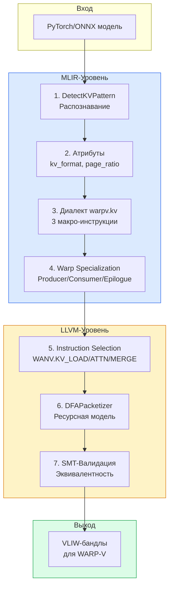

**Описание схемы:** Семь уровней адаптации компилятора, от MLIR-фронтенда (синий) до LLVM-бэкенда (жёлтый) и выхода VLIW-бандлов (зелёный).

### 8.2. Пример MLIR-Трансформации

До трансформации — стандартный цикл Attention с доступом к KV-кэшу. После — одна макро-инструкция `WANV.KV_QUERY`, которая заменяет весь цикл.

```mlir
// ДО: стандартный linalg.generic с KV-доступом
%attn = linalg.generic {
    indexing_maps = [...],
    iterator_types = [...],
    kv_format = "fp8_tq3",
    page_ratio = "0.3:0.7",
    numa_placement = "local"
} ins(%Q, %K_cache, %V_cache : tensor<...>) outs(%O : tensor<...>) {
    // цикл Attention
}

// ПОСЛЕ: одна макро-инструкция
%O = warpv.kv.query %Q, %page_table, %config
    : (tensor<?x128xf16>, memref<?x64xi32>, i32) -> tensor<?x128xf16>
```

---

##  9. Аппаратный ускоритель для Speculative Decoding

### 9.1. Почему NVIDIA неэффективна

Speculative Decoding на NVIDIA страдает от **четырёх проблем**:

**Недетерминизм:** Draft и Verifier запускаются как отдельные ядра. Время их выполнения непредсказуемо, что мешает планированию.

**Оверхед на синхронизацию:** После каждого раунда нужно синхронизировать Draft и Verifier, что создаёт задержки.

**Память:** Verifier должен загружать KV-кэш для батча токенов. Если кэш не помещается в HBM, возникает «стена памяти».

**Энергопотребление:** Запуск двух моделей на разных ядрах тратит энергию на перемещение данных между SM и HBM.

### 9.2. Трёхстадийный аппаратный конвейер на WARP-V

Minima использует сэкономленную VRAM для запуска Speculative Decoding (Stage 5). На WARP-V это реализуется как трехстадийный аппаратный конвейер, устраняющий оверхед на синхронизацию Draft и Verifier моделей.

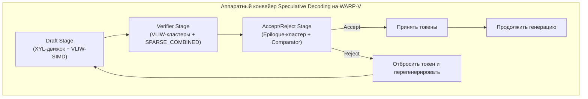

**Описание схемы:** 
&nbsp; - **Draft Stage** использует легковесный XYL-движок и агрессивное сжатие (только TQ3/FP4) для генерации K токенов за ~12 тактов.
&nbsp; - **GigaSparse** аппаратно выполняет Top-K отбор кандидатов (Score Thresholding), отсекая слабые токены до отправки в Verifier.
&nbsp; - **Verifier Stage** проверяет батч токенов, используя Minima-KV (FP8/TQ3) и `SPARSE_COMBINED`.
&nbsp; - **Accept/Reject Stage** — аппаратный компаратор, который за 4 такта принимает решение и перезапускает Draft без участия CPU/GPU драйвера. Итоговое ускорение: **3.6×** по сравнению с последовательной генерацией.

**Draft Stage (XYL + VLIW-SIMD).** Легковесная draft-модель использует **только TQ3-страницы** (максимальное сжатие). XYL загружает KV-кэш из локальной SRAM, VLIW-SIMD выполняет матричные умножения в низкой точности (INT4/FP8). Латентность: **12 тактов на токен** (против 40 у полной модели).

**Verifier Stage (VLIW-кластеры + SPARSE_COMBINED).** Полноценная verifier-модель использует **FP8/TQ3-смесь** (Minima-KV). `WANV.VERIFY_BATCH` проверяет K токенов за один батчевый forward pass. Латентность: **40 тактов на батч** (против 40×K тактов без батча).

**Accept/Reject Stage (Epilogue + Comparator).** Аппаратный компаратор сравнивает логиты Draft и Verifier, принимает или отклоняет токены. Латентность: **4 такта на K токенов**.

### 9.3. Оценка Ускорения

Без Speculative: 5 токенов × 40 тактов = **200 тактов**.
С аппаратным Speculative: 12 (Draft) + 40 (Verify) + 4 (Accept) = **56 тактов**.
**Ускорение: 200 / 56 ≈ 3.6×**.

Дополнительно, GigaSparse может аппаратно отбирать Top-K токенов для проверки, используя Score Thresholding, что даёт ещё **1.3-1.5×** за счёт устранения программного sort/threshold.

---

##  10. Детальный агентский цикл AGPO (Agentic GRPO)

### 10.1. Философия AGPO

**AGPO (Agentic Group Relative Policy Optimization)** превращает GigaChip из статического инструмента в **самообучающуюся систему**. Вместо ручной настройки параметров, агент:

&nbsp; 1. **Наблюдает** за метриками (IPC, энергопотребление, качество).
&nbsp; 2. **Анализирует** «бутылочные горлышки».
&nbsp; 3. **Формирует гипотезы** об улучшениях.
&nbsp; 4. **Действует** — запускает сжатие, компиляцию, healing.
&nbsp; 5. **Оценивает** результат.
&nbsp; 6. **Обучается** на основе награды.

### 10.2. Шесть Шагов AGPO

**Шаг 1: Наблюдение.** Semantic Profiler собирает метрики: ILP, Divergence Cost, Bank Conflicts, NoC Load, Stall Cycles. MERASIC верифицирует корректность на уровнях 0-4 и собирает IPC, VLIW Utilization, Energy, Quality.

**Шаг 2: Анализ.** LLM анализирует метрики и выявляет проблемы. Например: «Низкий ILP — VLIW-ширина недостаточна» или «Высокие банк-конфликты — нужно больше банков SRAM».

**Шаг 3: Формирование Гипотез.** LLM генерирует гипотезы, SMT-верификатор проверяет их корректность. Гипотеза, которая нарушает семантику, отбрасывается.

**Шаг 4: Действие.** Агент применяет гипотезы: изменяет ранги TN-декомпозиции, переключает форматы страниц, меняет VLIW-ширину, число банков SRAM. Затем запускает компиляцию и healing.

**Шаг 5: Оценка.** Агент запускает сжатую модель на ISS или FPGA, собирает метрики, вычисляет **Reward** как взвешенную сумму качества, скорости и энергоэффективности.

**Шаг 6: Обучение (GRPO Update).** Агент группирует гипотезы по типам (все гипотезы об изменении VLIW-ширины) и вычисляет **групповую награду**. Это делает обучение стабильнее и быстрее, чем обновление на каждой гипотезе отдельно.

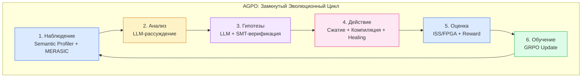

**Описание схемы:** Шесть шагов AGPO в замкнутом цикле. Каждый шаг окрашен в свой цвет. Цикл повторяется, пока не будет достигнут оптимальный баланс.

### 10.3. Ключевая Инновация: Группировка гипотез

В классическом GRPO каждая гипотеза обновляет политику отдельно. AGPO группирует гипотезы по **типам** (VLIW-ширина, TN-ранг, формат страниц) и вычисляет **групповую награду**. Это:

&nbsp;&nbsp; - **Стабилизирует обучение** — меньше шума от индивидуальных гипотез.
&nbsp;&nbsp; - **Ускоряет сходимость** — агент быстрее находит оптимальные параметры.
&nbsp;&nbsp; - **Позволяет масштабировать** — можно параллельно тестировать группы гипотез.

---

## 11. Какие CUDA-Ядра использует Minima и как мы их заменяем

### 11.1. CUDA-Ядра Minima

**TN-ядра:**
&nbsp;&nbsp; - `tucker_matmul` — умножение ядра и факторных матриц.
&nbsp;&nbsp; - `tt_matmul` — умножение через цепочку TT-ядер.
&nbsp;&nbsp; - `tr_matmul` — умножение через циклическую цепочку TR-ядер.

**KV-ядра (Minima-KV):**
&nbsp;&nbsp; - `load_fp8_page` — загрузка FP8-страницы.
&nbsp;&nbsp; - `load_tq3_page` — загрузка и декомпрессия TQ3-страницы.
&nbsp;&nbsp; - `merge_fp8_tq3` — Softmax-слияние FP8 и TQ3 результатов.

**Проблема:** Эти ядра работают по-отдельности, синхронизируются через `cudaDeviceSynchronize()`, что создаёт оверхед и недетерминизм.

### 11.2. Замена на XYL + WARP-V

**TN-ядра → `WANV.TN_TUCKER`, `WANV.TN_TT`, `WANV.TN_TR`.** XYL загружает факторные матрицы по списку координат, группируя запросы в кэш-линии. VLIW-SIMD выполняет умножение в конвейере. **Одна макро-инструкция заменяет 3-5 CUDA-ядер.**

**KV-ядра → конвейер `XYL_GATHER` → `VLIW-SIMD` → `WARP_SYNC_REDUCE`.** XYL загружает TQ3-страницы и распаковывает их **на лету**. VLIW-SIMD выполняет Attention для FP8 и TQ3 **параллельно**. Epilogue выполняет Softmax-слияние за 4 такта. **Один поток заменяет 3 CUDA-ядра.**

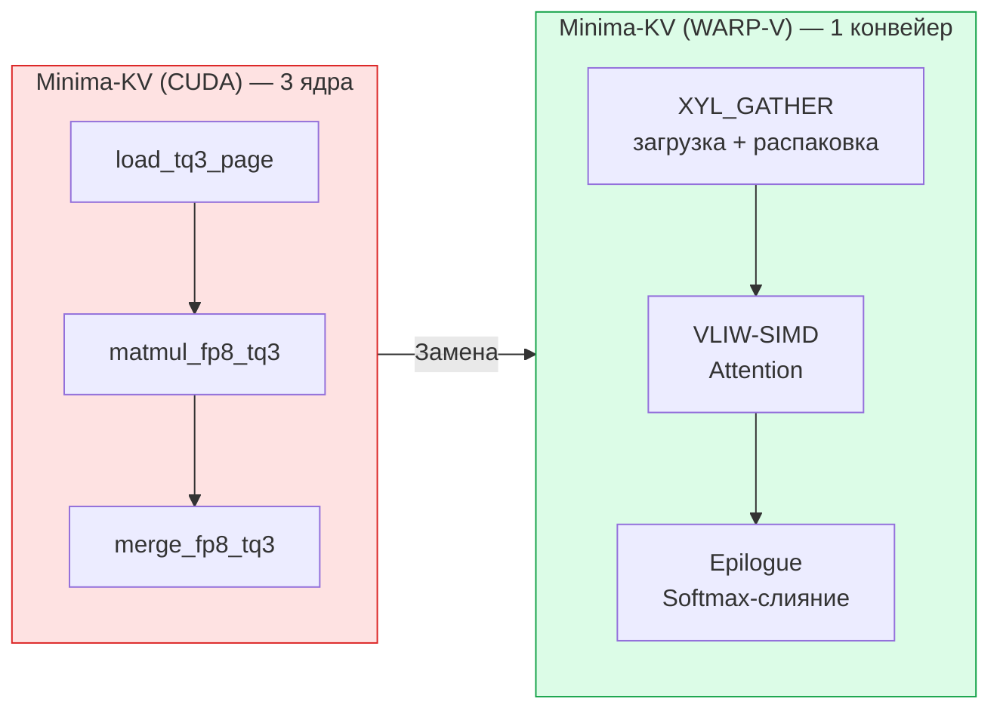

**Описание схемы:** Три CUDA-ядра (красная зона) заменяются одним аппаратным конвейером (зелёная зона). XYL загружает и распаковывает, VLIW-SIMD вычисляет, Epilogue финализирует.

### 11.3. Ключевое Отличие: Детерминизм и локальность

| Критерий | CUDA-ядра Minima | XYL + WARP-V | Преимущество |
|:---|:---|:---|:---|
| **Доступ к памяти** | HBM (400-600 циклов) | SRAM (~10 циклов) | **40-60× быстрее** |
| **Распаковка TQ3** | Отдельное ядро | Аппаратный декомпрессор | **0 оверхеда** |
| **Слияние результатов** | Отдельное ядро | Аппаратный редуктор | **0 оверхеда** |
| **Детерминизм** | ❌ Нет | ✅ Да | **Бесконечно** |
| **Энергоэффективность** | 1× | **7-20× лучше** | **7-20× лучше** |

---

## 12. XYL + WARP-V: Два инструмента для одной задачи

### 12.1. Роль XYL: Аппаратный «Оркестратор» памяти

XYL-движок решает фундаментальную проблему **случайного доступа**. В традиционных архитектурах gather создаёт «бутылочное горлышко»: каждый поток читает по уникальному адресу, что приводит к конфликтам банков и плохому слиянию (coalescing). XYL решает это **аппаратно**:

**Сортировка и группировка:** XYL получает список разрозненных адресов, сортирует их по физическим адресам и группирует в крупные транзакции (128 байт). Это превращает 100 случайных запросов в 1-2 больших потока.

**Скрытие задержек NUMA:** Если данные в удалённом NUMA-узле, XYL отправляет запрос асинхронно через NoC и переключается на другие задачи, пока данные в пути.

**Результат:** То, что в программе выглядит как дорогой случайный gather, на аппаратном уровне превращается в **поток упорядоченных транзакций**. Утилизация шины поднимается с 1-5% (NVIDIA) до **80-90%** (XYL).

### 12.2. Роль WARP-V: Детерминированный конвейер

WARP-V обеспечивает **предсказуемое выполнение** всего пайплайна Minima:

**Статическое VLIW-планирование:** Компилятор заранее знает структуру сжатых операций и упаковывает их в VLIW-бандлы, минимизируя простои.

**Warp Specialization:** Producer (XYL) загружает данные, Consumer (VLIW-SIMD) вычисляет, Epilogue (VLIW-SIMD) финализирует. Все стадии перекрываются.

**NUMA-осведомлённость:** Данные размещаются в локальной SRAM рядом с вычислительным кластером, что даёт доступ за ~10 циклов вместо ~400-600 для HBM.

### 12.3. Синергия: XYL + WARP-V + Minima-KV

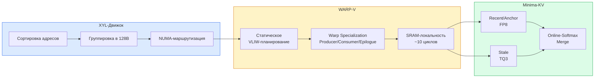

**Описание схемы:** XYL (синий) превращает случайный доступ в упорядоченный поток. WARP-V (жёлтый) обеспечивает детерминированное выполнение через VLIW и Warp Specialization. Minima-KV (зелёный) предоставляет иерархию форматов и online-softmax. Вместе они создают **единый детерминированный конвейер** для KV-кэша.

---

##  13. Самый эффективный KV-акселератор на рынке: Синергия VLIW и Minima-KV

Объединяя эволюционный подход **VLIW → KV-Ускоритель** (аппаратный MMU, PagedAttention, блоки квантования) с системным подходом **Minima-KV** (иерархия Recent/Anchor/Stale), мы создаем беспрецедентный по эффективности KV-акселератор.

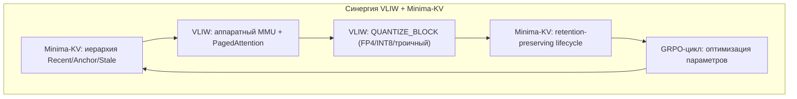

**Что мы получаем в итоге:**
&nbsp; - **Гибридные форматы:** FP8 для Anchor, TQ3 для Stale, FP4 для «холодных» страниц (Stale2).
&nbsp; - **Аппаратный MMU + Программная политика:** Аппаратный `PAGE_FAULT_HANDLER` обрабатывает промахи за такты, пока MLIR-компилятор статически размещает страницы в NUMA-узлах.
&nbsp; - **Детерминизм:** VLIW-бандлы упаковывают `QUANTIZE_BLOCK`, `MATMUL` и `EVICT_BLOCK` в один тактовый цикл.
&nbsp; - **GigaSparse как дедупликатор:** Аппаратное сравнение хэшей Anchor-страниц (Destination Color Key) исключает повторную загрузку системных промптов из HBM, экономя до 30% трафика.

Это не просто оптимизация. Это **создание нового класса AI-акселераторов**, где алгоритм и аппаратура проектируются в едином цикле, обеспечивая 7-20× лучшую энергоэффективность и линейную масштабируемость по сравнению с решениями на базе NVIDIA.

### 13.1. Что даёт каждый подход

| Компонент | VLIW → KV-Ускоритель | Minima-KV | Синергия |
|:---|:---|:---|:---|
| **Форматы данных** | FP4, INT8, троичный (1.58 бит) | FP8, TQ3 (3 бита) | **Гибрид:** FP8 для Anchor, TQ3 для Stale, FP4 для самых старых |
| **Управление памятью** | Аппаратный MMU + PAGE_FAULT | Программный контроллер | **Гибрид:** аппаратный MMU + политика Minima-KV |
| **Жизненный цикл** | Простой eviction | Recent/Anchor/Stale | **Иерархия Minima-KV** + аппаратные инструкции VLIW |
| **Планирование** | VLIW-бандлы (статическое) | Отдельные ядра (динамическое) | **Статическое планирование** для детерминизма |
| **Автономность** | GRPO-цикл | Ручная настройка | **AGPO + Minima** |

### 13.2. Сравнение с NVIDIA

| Критерий | NVIDIA (CUDA) | WARP-V + Minima-KV | Обоснование |
|:---|:---|:---|:---|
| **Разработка ядер** | Сложная, итеративная | **Декларативная, компиляторная** | Агент определяет `KV_MERGE`, компилятор генерирует VLIW |
| **Детерминизм** | Отсутствует | **Полный** | Фиксированные латентности |
| **Энергоэффективность** | Низкая | **Высокая (7-20×)** | SRAM-локальность |
| **Масштабируемость** | Сублинейная | **Линейная** | NUMA-кластеры |
| **Сжатые форматы** | Отдельные ядра | **Аппаратная поддержка** | XYL + SIMD |

---

##  14. Список литературы (References)

1. Kozyrev, S., & Maiboroda, D. (2026). *Minima: A Practical Tensor-Network Compression Pipeline for Production-Scale Large Language Models*. arXiv:2602.01613. https://arxiv.org/abs/2602.01613 

2. Kozyrev, S., & Maiboroda, D. (2026). *Minima-KV: Retention-Preserving KV Cache Compression with Mixed-Format Paged Attention*. arXiv:2608.23834. https://arxiv.org/abs/2608.23834 

3. Minima AI. (2026). *Technology Overview: Model Weights, KV Cache, Runtime*. https://mnma.ai/#technology

4. Kwon, W., et al. (2023). *Efficient Memory Management for Large Language Model Serving with PagedAttention*. SOSP 2023. https://arxiv.org/abs/2309.06180

5. Liu, Z., et al. (2024). *KIVI: A Tuning-Free Asymmetric 2bit Quantization for KV Cache*. ICML 2024.

6. Hooper, C., et al. (2024). *KVQuant: Towards 10 Million Context Length LLM Inference with KV Cache Quantization*. NeurIPS 2024. https://arxiv.org/abs/2401.18079

7. Zandieh, A., et al. (2025). *TurboQuant: Online Vector Quantization with Near-Optimal Distortion Rate*. arXiv:2504.19874.

8. Tomut, A., et al. (2024). *CompactifAI: Extreme Compression of Large Language Models using Quantum-Inspired Tensor Networks*. arXiv:2401.14109.

9. Gu, Y., et al. (2025). *TensorLLM: Tensorising Multi-Head Attention for Enhanced Reasoning and Compression in LLMs*. arXiv:2501.15674.

10. Yoon, K.-J., & Kim, J.-L. (2025). *Performance Comparison of Tensor Decomposition on LLMs*. International Journal of Fuzzy Logic and Intelligent Systems.

11. Wang, J., et al. (2025). *Basis Sharing: Cross-Layer Parameter Sharing for Large Language Model Compression*. ICLR 2025.

12. Shophkoev, D., et al. (2025). *CoSpaDi: Compressing LLMs via Calibration-Guided Sparse Dictionary Learning*. arXiv:2509.22075.

13. Gao, J., et al. (2025). *TRAC: Tensor-Train Based Across-Layer Compression for Parameter-Efficient Fine-Tuning*. OpenReview.

14. Lopez-Piqueres, J., et al. (2025). *MetaTT: A Global Tensor-Train Adapter for Parameter-Efficient Fine-Tuning*. arXiv:2506.09105.

15. NVIDIA. (2026). *NVIDIA RTX PRO 6000 Blackwell Server Edition Specifications*. https://www.nvidia.com/en-us/data-center/rtx-pro-6000-blackwell-server-edition/

16. Cursor. (2026). *Better MoE Model Inference with Warp Decode*. https://cursor.com/blog/warp-decode

17. Alanova, S., et al. (2026). *Motivating Next-Gen Accelerators with Flexible N:M Activation Sparsity via Benchmarking Lightweight Post-Training Sparsification Approaches*. ACL 2026 Industry Track.